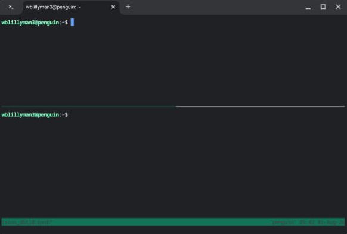
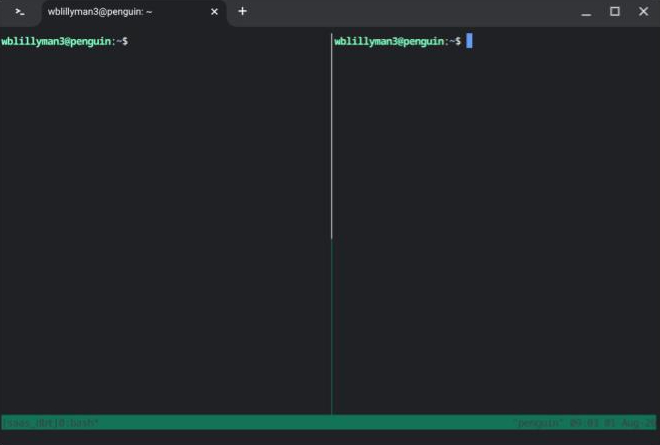

# Automated SaaS MRR Analytics Pipeline
> **Using dbt Core, Snowflake, Python, and Streamlit in Snowflake (SiS)**

An end-to-end analytics engineering pipeline that generates synthetic SaaS subscription log data, transforms raw event streams into an automated Monthly Recurring Revenue (MRR) waterfall model with dbt data quality assertions, and renders an executive dashboard natively inside Snowflake.

### Pipeline Architecture
`Python (Synthetic Data Ingestion)` ➔ `Snowflake (RAW Schema)` ➔ `dbt Core (Staging & Mart Views)` ➔ `Streamlit in Snowflake (Dashboard)`

---

### Technical Overview
* **Data Generation:** Python (`pandas`, `numpy`, `snowflake-connector`) generating multi-year subscription lifecycles (New, Expansion, Contraction, Churn).
* **Data Warehouse:** Snowflake AI Data Cloud (`SAAS_ANALYTICS`).
* **Transformation & Testing:** `dbt Core` with `stg_` source cleaning, `fct_mrr_monthly_waterfall` window aggregations, and schema-level data assertions (`unique`, `not_null`).
* **Visualization:** Streamlit in Snowflake (SiS) executive reporting layer.

Let’s get started\!

### Getting Started

#### Install tmux and direnv

Before we do anything else, we want to install `git`, `tmux`, and `direnv`. If you already have `tmux` (or another terminal multiplexer, or really don't want to use one), go ahead and skip that part, **but still install direnv**:

```bash
sudo apt update -y && sudo apt install git tmux direnv
```

Add the shell hook for direnv:  
```bash
eval "$(direnv hook bash)"
```

#### Create Your Project Directory

Open up your terminal and create a new working directory for your code. I house all my projects in my `~/code/` directory. After we create that, we'll navigate to the directory and clone the git repository.

```bash
mkdir ~/code && cd ~/code && git clone git@github.com:returnofthelambda/saas_mrr_dbt.git && cd saas_mrr_dbt
```

#### Start tmux

Start a new `tmux` session named `saas_dbt`  
```bash
tmux new -s saas_dbt
```

#### tmux Commands Crash Course

`tmux` uses keyboard commands to create panes and windows and to move between panes or windows. The default `prefix` command is `ctrl+b`. To create a new horizontal pane you run the `prefix` followed by `”` (press `ctrl` and `b` at the same time, release them and then press `”`, will be written as `prefix + “` moving forward); if you want a vertical pane it’s `prefix + %`.

##### Pane creation

Horizontal:


Vertical:


##### Moving Between Panes

To move from one pane to another, press `prefix` and the arrow key direction you want to move. If you have a vertical pane setup and are on the right pane (see the cursor position in the Vertical example above) you can press `prefix + {left arrow key}` or `prefix + {right arrow key}` since there are only two panes open.

You can find more in depth information on `tmux` [here](https://github.com/tmux/tmux/wiki/Getting-Started).

#### Initialize Your Virtual Environment

With all Python projects, it’s good practice to initialize a virtual environment to keep your package versions consistent for the project. Without a virtual environment, updating a package for one project can introduce breaking changes for the code in another project.

I use `venv` because it’s installed by default with Python3:

```bash
python3 -m venv .venv
```

Then we need to initialize the virtual environment:

```bash
source .venv/bin/activate
```

#### Install Required Python Packages

Now that our virtual environment is initialized, we install the packages we want to use. If you haven't cloned this repository, go to the git repository for this project and download the file called [requirements.txt](requirements.txt) to the `~/code/saas_mrr_dbt/` directory and then, from that directory with your **virtual environment initialized** run:

```bash
pip install -r requirements.txt
```

#### Create a Snowflake AI Data Cloud Account

If you don’t already have a Snowflake AI Data Cloud account, you can create one for a free 30 day trial at [https://signup.snowflake.com](https://signup.snowflake.com)

Once you’ve authenticated your account, on the left panel, go down to MANAGE \-\> ACCOUNT to get your account. You’ll need the org name and account number, which can be found by hovering over the `i` icon next to your Account name (see the blue arrow below). The value hidden by the red rectangle is what you’ll enter for your account in the next step:


#### Create Your .env File With Your Snowflake Account Information

From the `~/code/saas_mrr_dbt` directory create a `.env` file to store this information. I use vim, if you use emacs, please stop now and go reconsider your life choices… just kidding, use whatever text editor you prefer:

```bash
vim .env
```

When you paste the below code, remember to **UPDATE THE PLACEHOLDER VALUES TO ACTUALS**:

```env
# ~/code/saas_mrr_dbt/.env
SNOWFLAKE_ACCOUNT=above_redbox_value
SNOWFLAKE_USER=’your_username’ # KEEP THE SINGLE QUOTES HERE
SNOWFLAKE_PASSWORD=your_password
```

Save the file.

#### Initialize direnv

Now that our .env is created, create a `.envrc` file with only the below code:  

```bash
dotenv
```

Then run `direnv allow` once to approve the directory

#### Create Your dbt profiles.yml File

Now that you have your `.env` file set up, you’re ready to create your `dbt` main `profile.yml` file for projects. 

```bash
mkdir ~/.dbt && vim ~/.dbt/profiles.yml
```

And paste in the following code and save the file. Because the `.env` file contains your account information, you can use the jinja2 templating below to pull that information in:

```.yaml
# ~/.dbt/profiles.yml
saas_analytics:
  outputs:
    dev:
      type: snowflake
      account: "{{ env_var('SNOWFLAKE_ACCOUNT') }}"
      user: "{{ env_var('SNOWFLAKE_USER') }}"
      password: "{{ env_var('SNOWFLAKE_PASSWORD') }}"
      role: ACCOUNTADMIN
      warehouse: COMPUTE_WH
      database: SAAS_ANALYTICS
      schema: DEV
      threads: 4
  target: dev
```

#### Initialize the dbt Project

Now that we have our account information in the system and project set up in `~/.dbt/profiles.yml`, we can initialize our `dbt` project:

```bash
dbt init saas_analytics --skip-profile-setup
```

After this completes, go ahead and delete the `saas_analytics/models/example/` directory. If you leave it, it will run everytime you run a `dbt run` or `dbt test` command:

```bash
rm -rf saas_analytics/models/example
```

Then create the two directories we'll need later on:

```bash
mkdir saas_analytics/models/staging/ saas_analytics/models/marts
```

One last thing we should do to clean up before moving on. `dbt init` will create some additional code that we don't need. We can leave it, but it will throw a Config Warning later. Open up `saas_analytics/dbt_project.yml` and go down to the bottom of the file, remove the `example:` block under `saas_analytics:`, and add the folders we're going to create like this:

```yaml
...
models:
  saas_analytics:
    staging:
      +materialized: view
    marts:
      +materialized: view
```

### Generating Synthetic Data

#### Create Python Script to Generate Fake Data

Overview: We want to create a probablistic lifecycle data simulation. To do so, we'll use `numpy` and `pandas` to model customer subscription events. For this set I'm using fixed level revenue increases, but you could use percentages instead and multiply by the `initial_mrr` variable. 

Using our `.env` file and python-dotenv, we securely load our credentials instead of hardcoding them into the code. When we initialize the directory as a `git` repository (if you haven't cloned mine), we'll add a `.gitignore` file before we commit the code to exlude the .env file, that way our credentials won't be shared with the public:

```bash
# .gitignore
# dbt execution logs and build target
logs/
target/

# dbt dependencies (installed via `dbt deps`)
# not used here, but standard practice
dbt_packages/

# Environment variables & virtual environment
.env
.venv/
```

Snowflake requires column names to be all caps or else it can cause double quoting issues, so we convert the column names to uppercase before pushing the data to Snowflake.

Create the file `generate_raw_data.py` with the below code:

```python
# ~/code/saas_mrr_dbt/generate_raw_data.py
import pandas as pd
import numpy as np
from datetime import datetime, timedelta
import snowflake.connector
from snowflake.connector.pandas_tools import write_pandas
import os
from dotenv import load_dotenv

load_dotenv()

# Initialize modern NumPy Generator
rng = np.random.default_rng(42)
n_customers = 100

# rng.integers replaces np.random.randint
start_dates = [datetime(2025, 1, 1) + timedelta(days=int(x)) for x in rng.integers(0, 365, size=n_customers)]
records = []

for i in range(n_customers):
    cust_id = f"CUST_{1000 + i}"
    c_start = start_dates[i]
    # Base tiers of $100, $250, $500, and $1,000
    initial_mrr = rng.choice([100, 250, 500, 1000])
      
    # Initial subscription
    records.append({
        "event_id": f"EVT_{len(records)+1}",
        "customer_id": cust_id,
        "event_type": "NEW",
        "event_date": c_start.strftime("%Y-%m-%d"),
        "mrr_change": initial_mrr,
        "current_mrr": initial_mrr
    })
      
    # Simulate potential expansion/contraction or churn
    if rng.random() > 0.3:
        change_date = c_start + timedelta(days=int(rng.integers(60, 180)))
        if change_date < datetime(2026, 8, 1):
            # 50% chance of Expansion, 20% chance of Contraction, and 30% chance of Churn
            change_type = rng.choice(["EXPANSION", "CONTRACTION", "CHURN"],
                                     p=[0.5, 0.2, 0.3]
                                    )
            if change_type == "EXPANSION":
                # Equal weighted chance for Subscription Expansion Revenue
                # For thsi example we're using fixed revenue addons, but you could also use percentages and multiply by the initial_mrr value
                delta = rng.choice([50, 100, 250])
                new_mrr = initial_mrr + delta
            elif change_type == "CONTRACTION":
                delta = -min(initial_mrr / 2, 100)
                new_mrr = initial_mrr + delta
            else: # CHURN
                delta = -initial_mrr
                new_mrr = 0
                  
            records.append({
                "event_id": f"EVT_{len(records)+1}",
                "customer_id": cust_id,
                "event_type": change_type,
                "event_date": change_date.strftime("%Y-%m-%d"),
                "mrr_change": delta,
                "current_mrr": new_mrr
            })

df = pd.DataFrame(records)

# Push to Snowflake
conn = snowflake.connector.connect(
    user=os.getenv("SNOWFLAKE_USER"),
    password=os.getenv("SNOWFLAKE_PASSWORD"),
    account=os.getenv("SNOWFLAKE_ACCOUNT"),
    warehouse='COMPUTE_WH',
    database='SAAS_ANALYTICS',
    schema='RAW'
)

cursor = conn.cursor()
cursor.execute("CREATE DATABASE IF NOT EXISTS SAAS_ANALYTICS;")
cursor.execute("CREATE SCHEMA IF NOT EXISTS SAAS_ANALYTICS.RAW;")
cursor.execute("USE SCHEMA SAAS_ANALYTICS.RAW;")

# Uppercase column names for Snowflake schema normaliztion
df.columns = [c.upper() for c in df.columns]

write_pandas(conn, df, "SUBSCRIPTION_EVENTS", auto_create_table=True, overwrite=True)
print("Successfully generated and loaded RAW.SUBSCRIPTION_EVENTS to Snowflake.")
```

With the file saved and our `dbt` project initialized, we can run the `generate_raw_data.py` file to create our synthetic data:

```bash
python3 generate_raw_data.py
```

If everything has been set up correctly, we’ll get the message: `Successfully generated and loaded RAW.SUBSCRIPTION_EVENTS to Snowflake.`

If you get an error message, make sure that you are in the correct directory and that you have activated your virtual environment by running: `source .venv/bin/activate` from within `~/code/saas_mrr_dbt`

### dbt Models & Data Tests

Inside the `dbt` project directory `saas_analytics/`, there is a `models/` directory. This is where we're going to create our staging model, the intermediate MRR waterfall fact table, and schema test.

#### Staging Model

In `dbt`, **staging models** clean up raw source data and provide us with an intermediate layer to work on while leaving our raw data untouched. We will use `cast` to change raw variant types to explicit Snowflake datatypes such as `varchar`, `date`, and `numeric(16,2)` (the (16,2) means it will have no more than 16 total digits, two of which are decimals). We will also use cast to update names to more reader friendly names, such as changing `current_mrr` to `ending_mrr_amount`.

. In your editor, create a file `saas_analytics/models/staging/stg_subscription_events.sql` and populate it with the following code:

```sql
-- saas_analytics/models/staging/stg_subscription_events.sql
with source as (
    select * from {{ source('raw', 'subscription_events') }}
),

renamed as (
    select
        cast(event_id as varchar) as event_id,
        cast(customer_id as varchar) as customer_id,
        cast(event_type as varchar) as event_type,
        cast(event_date as date) as event_date,
        cast(mrr_change as numeric(16,2)) as mrr_change_amount,
        cast(current_mrr as numeric(16,2)) as ending_mrr_amount
    from source
)

select * from renamed
```

#### The Mart MRR Waterfall Model

In `dbt` design conventions, **marts** are the models that produce teh final business ready tables, specifically for reporting and BI tools. Here, we're going to create our MRR Monthly Waterfall model. We're going to group events into monthly buckets using `DATE_TRUNC` and use conditonal sum logic (`SUM(CASE WHEN event_type ...)`) to pivot events into discrete MRR expansion/contraction/churn buckets.

Using a cumulative window function (`SUM(net_mrr_change) OVER (ORDER BY mrr_month ROWS BETWEEN UNBOUNDED PRECEDING AND CURRENT ROW)`), we can calculate ending MRR and ensure balance sheet integrity bacross time periods.

We used `stg_` as the prefix for the staging model. Here we're creating a quantitative measure, so we'll use `fct_` as shorthand for fact / fact table. If we were creating a descriptive or qualitative analysis, we would use the `dim_` prefix as shorthand for dimension:

```bash
vim saas_analytics/models/marts/fct_mrr_monthly_waterfall.sql
```

```sql
-- saas_analytics/models/marts/fct_mrr_monthly_waterfall.sql
with events as (
    select * from {{ ref('stg_subscription_events') }}
),

monthly_aggregation as (
    select
        date_trunc('month', event_date) as mrr_month,
        sum(case when event_type = 'NEW' then mrr_change_amount else 0 end) as new_mrr,
        sum(case when event_type = 'EXPANSION' then mrr_change_amount else 0 end) as expansion_mrr,
        sum(case when event_type = 'CONTRACTION' then mrr_change_amount else 0 end) as contraction_mrr,
        sum(case when event_type = 'CHURN' then mrr_change_amount else 0 end) as churn_mrr,
        sum(mrr_change_amount) as net_mrr_change
    from events
    group by 1
)

select
    mrr_month,
    new_mrr,
    expansion_mrr,
    contraction_mrr,
    churn_mrr,
    net_mrr_change,
    sum(net_mrr_change) over (order by mrr_month rows between unbounded preceding and current row) as ending_mrr
from monthly_aggregation
order by mrr_month
```
#### Marts Model Testing

We also want to create a test for a Waterfall mart model. To do so, we create a `schema.yml` file in the `saas_analytics/models/marts/` directory and reference the model name and columns we want to test:

```bash
vim saas_analytics/models/marts/schema.yml
```

```yaml
# saas_analytics/models/marts/schema.yml
version: 2

models:
  - name: fct_mrr_monthly_waterfall
    description: "Monthly SaaS MRR Waterfall aggregate table"
    columns:
      - name: mrr_month
        tests:
          - unique
          - not_null
      - name: ending_mrr
        tests:
          - not_null
```

Save this file and now your directory tree should look like 


### Verifying, Running, and Testing

#### Verifying

To verify your code, navigate to your `saas_analytics/` directory:

```bash
cd ~/code/saas_mrr_dbt/saas_analytics
```

And run:

```bash
dbt debug
```

This will run a test to make sure all files are where they should be and that your connection settings are correct. Assuming that they are, you will see a green All checks passed! message.

If you get an error message, make sure that you are in the correct directory and that you have activated your virtual environment by running: `source .venv/bin/activate` from within `~/code/saas_mrr_dbt`

#### Running

While still in the `saas_analytics` directory, you can build your data pipeline in Snowflake using:

```bash
dbt run
```

Ideally, you will see a green `Completed succesfully` message and you're ready to test the data.

#### Testing

While still in the `saas_analytics` directory, you can test your data pipeline in Snowflake using:

```bash
dbt test
```

Just like above, ideally, you will see a green `Completed succesfully` message and you're ready to test the data.

### Serving and Exploring the Documentation for the Data

To serve the dbt data docs, from the `~/code/saas_mrr_dbt/saas_analytics` directory run:

```bash
dbt docs generate && dbt docs serve
```

If the docs generate but you get an `Address already in use` error message, that means you have another service running on port 8080. If you want that service to remain running, you can re-run with:

```bash
docs serve --port 8001
```

### Using dbt to View a Summary of the Data

Before we log into Snowflake, we can view a summary of the data by running the following code from the `saas_analytics/` directory:

```bash
dbt show --select fct_mrr_monthly_waterfall
```

Here's my data (remember, we created unique synthetic data, so your results will differ from mine


## Diving into Snowflake and Streamlit

Log back into Snowflake and go down to Workspaces -> Streamlit.

At the top of the new panel, switch from Workspaces to Databases and find `SAAS_ANALYTICS` and open up `DEV -> Views -> FCT_MRR_MONTHLY_WATERFALL`

In the center column, press the `+` button to create a new file `mrr_dashboard.py` with the below code. Double check that your path to the `FCT_MRR_MONTHLY_WATERFALL` matches:

```python
# mrr_dashboard.py
import streamlit as st
from snowflake.snowpark.context import get_active_session

session = get_active_session()
df = session.sql("SELECT * FROM SAAS_ANALYTICS.DEV.FCT_MRR_MONTHLY_WATERFALL ORDER BY MRR_MONTH").to_pandas()

st.title("SaaS Executive MRR Dashboard")
latest = df.iloc[-1]

col1, col2, col3 = st.columns(3)
col1.metric("Ending MRR", f"${latest['ENDING_MRR']:,.0f}")
col2.metric("New MRR", f"${latest['NEW_MRR']:,.0f}")
col3.metric("Churn MRR", f"${latest['CHURN_MRR']:,.0f}")

st.subheader("MRR Movement Over Time")
st.bar_chart(df, x="MRR_MONTH", y=["NEW_MRR", "EXPANSION_MRR", "CONTRACTION_MRR", "CHURN_MRR"])
st.line_chart(df, x="MRR_MONTH", y="ENDING_MRR")
```

Here you will be prompted with a Yellow warning box stating that this looks like a Streamlit app and needs to be converted. Go ahead and click the Convert to Streamlit app link and press OK.

This will convert it and run the Streamlit dashboard and you'll see something similar to this (again, the synthetic data you generated will be different than mine):


