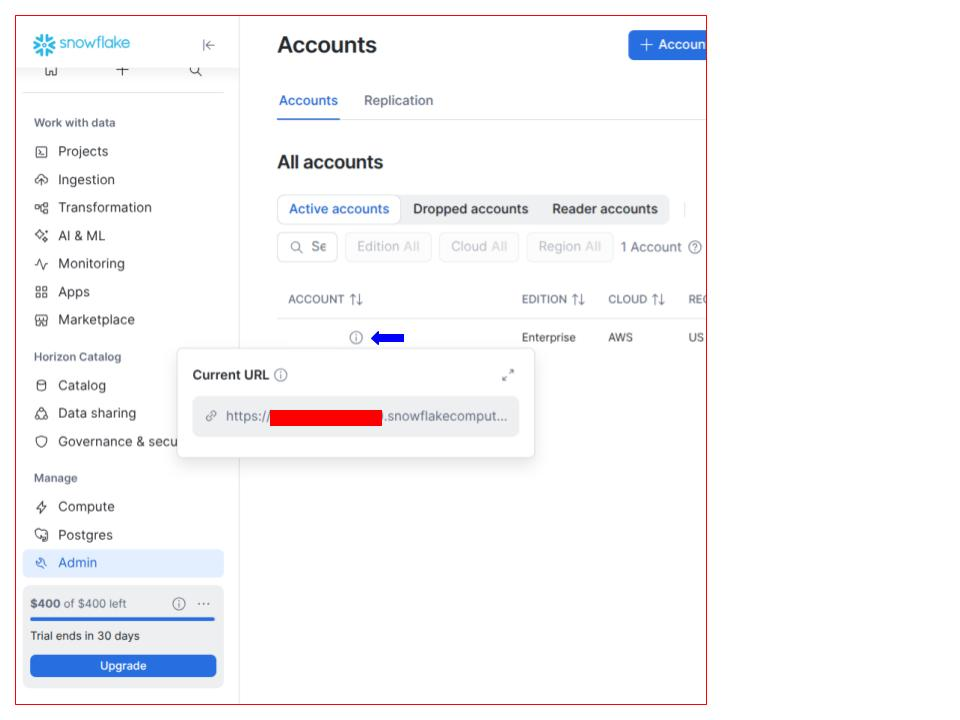

# Automated SaaS MRR Analytics Pipeline
> **A 3-Part Analytics Engineering Guide: Cloud-Native (Snowflake) or Locally Hosted (DuckDB)**

An end-to-end analytics engineering pipeline that generates synthetic SaaS subscription log data, transforms raw event streams into an automated Monthly Recurring Revenue (MRR) waterfall model with dbt data quality assertions, and renders executive reporting dashboards.

### Choose Your Own Adventure
* **Option A (Cloud-Native):** `Python` -> `Snowflake` -> `dbt-snowflake` -> `Streamlit in Snowflake`
* **Option B (Zero-Cost Local):** `Python` -> `DuckDB` -> `dbt-duckdb` -> `Local Streamlit`

---
## Part 1: Synthetic Data Generation and Ingestion

### Technical Overview
* **Data Generation:** Python (`pandas`, `numpy`, `snowflake-connector`) generating multi-year subscription lifecycles (New, Expansion, Contraction, Churn).
* **Data Warehouse:** Snowflake AI Data Cloud or DuckDB (`SAAS_ANALYTICS`)

If you're looking for the next steps:
[Part 2: dbt Data Processing](PART_2_DBT.md)
[Part 3: Data Visualization with Streamlit](PART_3_BI.md)

Let’s get started\!

### Getting Started

#### Install direnv and git

This walkthrough assumes you have python3 installed and you know how to get to the terminal. 

Before we do anything else, we want to install `git` and `direnv`:

```bash
sudo apt update -y && sudo apt install git direnv
```

Add the shell hook for direnv:  
```bash
eval "$(direnv hook bash)"
```

#### Create Your Project Directory

Open up your terminal and create a new working directory for your code. I house all my projects in my `~/code/` directory. After we create that, we'll navigate to the directory and clone the git repository.

```bash
mkdir ~/code && cd ~/code && git clone git@github.com:returnofthelambda/saas_mrr_dbt.git && cd saas_mrr_dbt
```

#### Initialize Your Virtual Environment

With all Python projects, it’s good practice to initialize a virtual environment to keep your package versions consistent for the project. Without a virtual environment, updating a package for one project can introduce breaking changes for the code in another project.

I use `venv` because it’s installed by default with Python3:

```bash
python3 -m venv .venv
```

Then we need to initialize the virtual environment:

```bash
source .venv/bin/activate
```

#### Install Required Python Packages

Now that our virtual environment is initialized, we install the packages we want to use. If you haven't cloned this repository, go to the git repository for this project and download the file called [requirements.txt](requirements.txt) to the `~/code/saas_mrr_dbt/` directory and then, from that directory with your **virtual environment initialized** run:

```bash
pip install -r requirements.txt
```

#### Create a Snowflake AI Data Cloud Account

If you don’t already have a Snowflake AI Data Cloud account, you can create one for a free 30 day trial at [https://signup.snowflake.com](https://signup.snowflake.com)

Once you’ve authenticated your account, on the left panel, go down to MANAGE \-\> ACCOUNT to get your account. You’ll need the org name and account number, which can be found by hovering over the `i` icon next to your Account name (see the blue arrow below). The value hidden by the red rectangle is what you’ll enter for your account in the next step:



#### Create Your .env File With Your Snowflake Account Information

From the `~/code/saas_mrr_dbt` directory create a `.env` file to store this information. I use vim, if you use emacs, please stop now and go reconsider your life choices… just kidding, use whatever text editor you prefer:

```bash
vim .env
```

When you paste the below code, remember to **UPDATE THE PLACEHOLDER VALUES TO ACTUALS**:

```env
# ~/code/saas_mrr_dbt/.env
# UPDATE THESE
SNOWFLAKE_ACCOUNT='above_redbox_value' # KEEP THE SINGLE QUOTES HERE
SNOWFLAKE_USER='your_username' # KEEP THE SINGLE QUOTES HERE
SNOWFLAKE_PASSWORD='your_password' # KEEP THE SINGLE QUOTES HERE
TARGET_DB=duckdb # or snowflake

# ONLY UPDATE THESE IF YOU KNOW WHAT YOU'RE DOING
SNOWFLAKE_ROLE=ACCOUNTADMIN
SNOWFLAKE_WAREHOUSE=COMPUTE_WH
SNOWFLAKE_DB=SAAS_ANALYTICS
SNOWFLAKE_SCHEMA=DEV
```

Save the file.

#### Initialize direnv

Now that our .env is created, create a `.envrc` file with only the below code:  

```bash
dotenv
```

Then you need add the `.env` file to `direnv`'s allow list:

```bash
direnv allow
```

#### Create Your dbt profiles.yml File

Now that you have your `.env` file set up, you’re ready to create your `dbt` main `profile.yml` file for projects. 

```bash
mkdir ~/.dbt && vim ~/.dbt/profiles.yml
```

And paste in the following code and save the file. Because the `.env` file contains your account information, you can use the jinja2 templating below to pull that information in:

```.yaml
# ~/.dbt/profiles.yml
saas_analytics:
  target: "dev_{{ env_var('TARGET_DB', 'snowflake') }}"
  outputs:
    dev_snowflake:
      type: snowflake
      account: "{{ env_var('SNOWFLAKE_ACCOUNT') }}"
      user: "{{ env_var('SNOWFLAKE_USER') }}"
      password: "{{ env_var('SNOWFLAKE_PASSWORD') }}"
      role: "{{ env_var('SNOWFLAKE_ROLE') }}"
      warehouse: "{{ env_var('SNOWFLAKE_WAREHOUSE') }}"
      database: "{{ env_var('SNOWFLAKE_DB') }}"
      schema: "{{ env_var('SNOWFLAKE_SCHEMA') }}"
      threads: 4
    dev_duckdb:
      type: duckdb
      path: "../data/saas_analytics.duckdb"
      schema: dev
      threads: 1
```

#### Initialize the dbt Project

Now that we have our account information in the system and project set up in `~/.dbt/profiles.yml`, we can initialize our `dbt` project:

```bash
dbt init saas_analytics --skip-profile-setup
```

After this completes, go ahead and delete the `saas_analytics/models/example/` directory. If you leave it, it will run everytime you run a `dbt run` or `dbt test` command:

```bash
rm -rf saas_analytics/models/example
```

Then create the two directories we'll need later on:

```bash
mkdir saas_analytics/models/staging/ saas_analytics/models/marts
```

One last thing we should do to clean up before moving on. `dbt init` will create some additional code that we don't need. We can leave it, but it will throw a Config Warning later. Open up `saas_analytics/dbt_project.yml` and go down to the bottom of the file, remove the `example:` block under `saas_analytics:`, and add the folders we're going to create like this:

```yaml
...
models:
  saas_analytics:
    staging:
      +materialized: view
    marts:
      +materialized: view
```

### Generating Synthetic Data

#### Create Python Script to Generate Fake Data

Overview: We want to create a probablistic lifecycle data simulation. To do so, we'll use `numpy` and `pandas` to model customer subscription events. For this set I'm using fixed level revenue increases, but you could use percentages instead and multiply by the `initial_mrr` variable. 

Using our `.env` file and python-dotenv, we securely load our credentials instead of hardcoding them into the code. When we initialize the directory as a `git` repository (if you haven't cloned mine), we'll add a `.gitignore` file before we commit the code to exlude the .env file, that way our credentials won't be shared with the public:

```bash
# .gitignore
# dbt execution logs and build target
logs/
target/

# dbt dependencies (installed via `dbt deps`)
# not used here, but standard practice
dbt_packages/

# Environment variables & virtual environment
.env
.venv/

# Local Databases
data/*.duckdb
data/*parquet
```

Now we're going to generate our data and pass it to our database connector. The default for this whole program is Snowflake, but when you run this code, you can call it with `python3 generate_raw_data.py --target duckdb` to send the data to DuckDB instead of Snowflake.

Snowflake requires column names to be all caps or else it can cause double quoting issues, so we convert the column names to uppercase before pushing the data to Snowflake. Even though DuckDB is case insensitive and doesn't need the normalization, we still use it so our later `dbt` code can be reused for either data warehouse.

Create the file `generate_raw_data.py` with the below code:

```python
# ~/code/saas_mrr_dbt/generate_raw_data.py
import argparse
import pandas as pd
import numpy as np
from datetime import datetime, timedelta
import os
from dotenv import load_dotenv

load_dotenv()

# Parse CLI arguments for database selection
parser = argparse.ArgumentParser(description="Generate synthetic SaaS MRR data.")
parser.add_argument(
    "--target",
    choices=["snowflake", "duckdb"],
    default=os.getenv("TARGET_DB", "snowflake"),
    help="Target database platform (default: snowflake)",
)
args = parser.parse_args()

# Initialize modern NumPy Generator
rng = np.random.default_rng(42)
n_customers = 100

start_dates = [
    datetime(2025, 1, 1) + timedelta(days=int(x))
    for x in rng.integers(0, 365, size=n_customers)
]
records = []

for i in range(n_customers):
  cust_id = f"CUST_{1000 + i}"
  c_start = start_dates[i]
  initial_mrr = rng.choice([100, 250, 500, 1000])

  records.append({
      "event_id": f"EVT_{len(records)+1}",
      "customer_id": cust_id,
      "event_type": "NEW",
      "event_date": c_start.strftime("%Y-%m-%d"),
      "mrr_change": initial_mrr,
      "current_mrr": initial_mrr,
  })

  if rng.random() > 0.3:
    change_date = c_start + timedelta(days=int(rng.integers(60, 180)))
    if change_date < datetime(2026, 8, 1):
      change_type = rng.choice(
          ["EXPANSION", "CONTRACTION", "CHURN"], p=[0.5, 0.2, 0.3]
      )
      if change_type == "EXPANSION":
        delta = rng.choice([50, 100, 250])
        new_mrr = initial_mrr + delta
      elif change_type == "CONTRACTION":
        delta = -min(initial_mrr / 2, 100)
        new_mrr = initial_mrr + delta
      else:  # CHURN
        delta = -initial_mrr
        new_mrr = 0

      records.append({
          "event_id": f"EVT_{len(records)+1}",
          "customer_id": cust_id,
          "event_type": change_type,
          "event_date": change_date.strftime("%Y-%m-%d"),
          "mrr_change": delta,
          "current_mrr": new_mrr,
      })

df = pd.DataFrame(records)

# Uppercase column names for database identifier normalization
df.columns = [c.upper() for c in df.columns]

if args.target == "duckdb":
  import duckdb

  os.makedirs("data", exist_ok=True)
  conn = duckdb.connect("data/saas_analytics.duckdb")
  conn.execute("CREATE SCHEMA IF NOT EXISTS RAW;")
  conn.execute(
      "CREATE OR REPLACE TABLE RAW.SUBSCRIPTION_EVENTS AS SELECT * FROM df"
  )
  conn.close()
  print(
      "Successfully generated and loaded RAW.SUBSCRIPTION_EVENTS to DuckDB"
      " (data/saas_analytics.duckdb)."
  )

elif args.target == "snowflake":
  import snowflake.connector
  from snowflake.connector.pandas_tools import write_pandas

  conn = snowflake.connector.connect(
      user=os.getenv("SNOWFLAKE_USER"),
      password=os.getenv("SNOWFLAKE_PASSWORD"),
      account=os.getenv("SNOWFLAKE_ACCOUNT"),
      warehouse="COMPUTE_WH",
      database="SAAS_ANALYTICS",
      schema="RAW",
  )

  cursor = conn.cursor()
  cursor.execute("CREATE DATABASE IF NOT EXISTS SAAS_ANALYTICS;")
  cursor.execute("CREATE SCHEMA IF NOT EXISTS SAAS_ANALYTICS.RAW;")
  cursor.execute("USE SCHEMA SAAS_ANALYTICS.RAW;")

  write_pandas(
      conn, df, "SUBSCRIPTION_EVENTS", auto_create_table=True, overwrite=True
  )
  print(
      "Successfully generated and loaded RAW.SUBSCRIPTION_EVENTS to Snowflake."
  )
```

With the file saved and our `dbt` project initialized, we can run the `generate_raw_data.py` file to create our synthetic data and send it to Snowflake or DuckDB:

```bash
python3 generate_raw_data.py --target snowflake # or --target duckdb
```

If everything has been set up correctly, we’ll get the message: `Successfully generated and loaded RAW.SUBSCRIPTION_EVENTS to Snowflake.`

If you get an error message, make sure that you are in the correct directory and that you have activated your virtual environment by running: `source .venv/bin/activate` from within `~/code/saas_mrr_dbt`

#### Next Steps

[Continue to Part 2: dbt Data Processing](PART_2_DBT.md)

[Skip to Part 3: Data Visualization with Streamlit](PART_3_BI.md)
