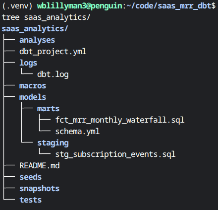
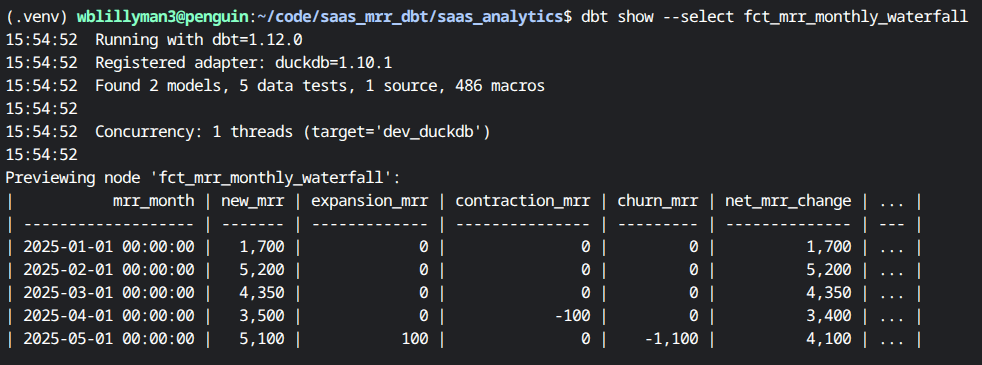

# Automated SaaS MRR Analytics Pipeline
> **A 3-Part Analytics Engineering Guide: Cloud-Native (Snowflake) or Locally Hosted (DuckDB)**

An end-to-end analytics engineering pipeline that generates synthetic SaaS subscription log data, transforms raw event streams into an automated Monthly Recurring Revenue (MRR) waterfall model with dbt data quality assertions, and renders executive reporting dashboards.

### Choose Your Own Adventure
* **Option A (Cloud-Native):** `Python` -> `Snowflake` -> `dbt-snowflake` -> `Streamlit in Snowflake`
* **Option B (Zero-Cost Local):** `Python` -> `DuckDB` -> `dbt-duckdb` -> `Local Streamlit`

---

## Part 2: dbt Data Transformation and Testing

### Technical Overview
* **Transformation & Testing:** `dbt Core` with `stg_` source cleaning, `fct_mrr_monthly_waterfall` window aggregations, and schema-level data assertions (`unique`, `not_null`).

Let’s get started\!

### Getting Started

**If you haven't already cloned the repository and set up your environment, go back to [Part 1](PART_1_INGESTION.md).**

### dbt Models & Data Tests

Inside the `dbt` project directory `saas_analytics/`, there is a `models/` directory. This is where we're going to create our staging model, the intermediate MRR waterfall fact table, and schema test.

#### Staging Model

In `dbt`, **staging models** clean up raw source data and provide us with an intermediate layer to work on while leaving our raw data untouched. We will use `cast` to change raw variant types to explicit Snowflake datatypes such as `varchar`, `date`, and `numeric(16,2)` (the (16,2) means it will have no more than 16 total digits, two of which are decimals). We will also use cast to update names to more reader friendly names, such as changing `current_mrr` to `ending_mrr_amount`.

In your editor, create a file `saas_analytics/models/staging/stg_subscription_events.sql` and populate it with the following code:

```sql
-- saas_analytics/models/staging/stg_subscription_events.sql
with source as (
    select * from {{ source('raw', 'subscription_events') }}
),

renamed as (
    select
        cast(event_id as varchar) as event_id,
        cast(customer_id as varchar) as customer_id,
        cast(event_type as varchar) as event_type,
        cast(event_date as date) as event_date,
        cast(mrr_change as numeric(16,2)) as mrr_change_amount,
        cast(current_mrr as numeric(16,2)) as ending_mrr_amount
    from source
)

select * from renamed
```

#### Staging Raw Source Configuration

In addition to the staging model, we need to create a `src_raw.yml` file so our staging model declares the raw tables to dbt. Without this the `{{source ('raw', 'subscription_events') }}` code will fail. This tells `dbt` where the raw data lands and  will also conduct quality tests on the `event_id` column:

```yaml
# saas_analytics/models/staging/src_raw.yml
version: 2

sources:
  - name: raw
    schema: raw
    description: "Raw transactional data ingested via Python"
    tables:
      - name: subscription_events
        description: "Raw SaaS customer subscription change events"
        columns:
          - name: event_id
            description: "Primary key for subscription events"
            tests:
              - unique
              - not_null
```

#### The Mart MRR Waterfall Model

In `dbt` design conventions, **marts** are the models that produce the final business ready tables, specifically for reporting and BI tools. Here, we're going to create our MRR Monthly Waterfall model. We're going to group events into monthly buckets using `DATE_TRUNC` and use conditonal sum logic (`SUM(CASE WHEN event_type ...)`) to pivot events into discrete MRR expansion/contraction/churn buckets.

Using a cumulative window function (`SUM(net_mrr_change) OVER (ORDER BY mrr_month ROWS BETWEEN UNBOUNDED PRECEDING AND CURRENT ROW)`), we can calculate ending MRR and ensure balance sheet integrity across time periods.

We used `stg_` as the prefix for the staging model. Here we're creating a quantitative measure, so we'll use `fct_` as shorthand for fact / fact table. If we were creating a descriptive or qualitative analysis, we would use the `dim_` prefix as shorthand for dimension:

```bash
vim saas_analytics/models/marts/fct_mrr_monthly_waterfall.sql
```

```sql
-- saas_analytics/models/marts/fct_mrr_monthly_waterfall.sql
with events as (
    select * from {{ ref('stg_subscription_events') }}
),

monthly_aggregation as (
    select
        date_trunc('month', event_date) as mrr_month,
        sum(case when event_type = 'NEW' then mrr_change_amount else 0 end) as new_mrr,
        sum(case when event_type = 'EXPANSION' then mrr_change_amount else 0 end) as expansion_mrr,
        sum(case when event_type = 'CONTRACTION' then mrr_change_amount else 0 end) as contraction_mrr,
        sum(case when event_type = 'CHURN' then mrr_change_amount else 0 end) as churn_mrr,
        sum(mrr_change_amount) as net_mrr_change
    from events
    group by 1
)

select
    mrr_month,
    new_mrr,
    expansion_mrr,
    contraction_mrr,
    churn_mrr,
    net_mrr_change,
    sum(net_mrr_change) over (order by mrr_month rows between unbounded preceding and current row) as ending_mrr
from monthly_aggregation
order by mrr_month
```
#### Marts Model Testing

We also want to create a test for a Waterfall mart model. To do so, we create a `schema.yml` file in the `saas_analytics/models/marts/` directory and reference the model name and columns we want to test:

```bash
vim saas_analytics/models/marts/schema.yml
```

```yaml
# saas_analytics/models/marts/schema.yml
version: 2

models:
  - name: fct_mrr_monthly_waterfall
    description: "Monthly SaaS MRR Waterfall aggregate table"
    columns:
      - name: mrr_month
        tests:
          - unique
          - not_null
      - name: ending_mrr
        tests:
          - not_null
```

Save this file and now your directory tree should look like 



### Verifying, Running, and Testing

#### Verifying

To verify your code, navigate to your `saas_analytics/` directory:

```bash
cd ~/code/saas_mrr_dbt/saas_analytics
```

And run:

```bash
dbt debug
```

This will run a test to make sure all files are where they should be and that your connection settings are correct. Assuming that they are, you will see a green All checks passed! message.

If you get an error message, make sure that you are in the correct directory and that you have activated your virtual environment by running: `source .venv/bin/activate` from within `~/code/saas_mrr_dbt`

#### Running

While still in the `saas_analytics` directory, you can build your data pipeline. For Snowflake, use `--target dev_snowflake` for DuckDB, `--target dev_duckdb`. These `targets` were configured in [Step 1](PART_1_INGESTION.md#create-your-dbt-profilesyml-file)

```bash
dbt run --target dev_snowflake # or --target dev_duckdb
```

Ideally, you will see a green `Completed succesfully` message and you're ready to test the data.

#### Testing

While still in the `saas_analytics` directory, you can test your data pipeline in Snowflake or DuckDB using:

```bash
dbt test --target dev_snowflake # or --target dev_duckdb
```

Just like above, ideally, you will see a green `Completed succesfully` message and you're ready to test the data.

### Serving and Exploring the Documentation for the Data

To serve the dbt data docs, from the `~/code/saas_mrr_dbt/saas_analytics` directory run:

```bash
dbt docs generate && dbt docs serve
```

If the docs generate but you get an `Address already in use` error message, that means you have another service running on port 8080. If you want that service to remain running, you can re-run with a less common port such as 8001:

```bash
dbt docs serve --port 8001
```

### Using dbt to View a Summary of the Data

Before we log into Snowflake, we can view a summary of the data by running the following code from the `saas_analytics/` directory:

```bash
dbt show --select fct_mrr_monthly_waterfall
```

Here's my data. Remember, we created unique synthetic data, so your results will differ from mine.



#### Next Steps

[Go Back to Part 1: Data Generation and Ingestion](PART_1_INGESTION.md)

[Continue to Part 3: Data Visualization with Streamlit](PART_3_BI.md)
