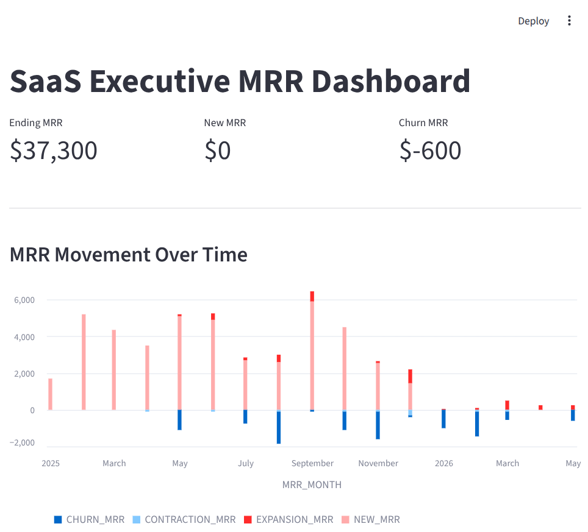
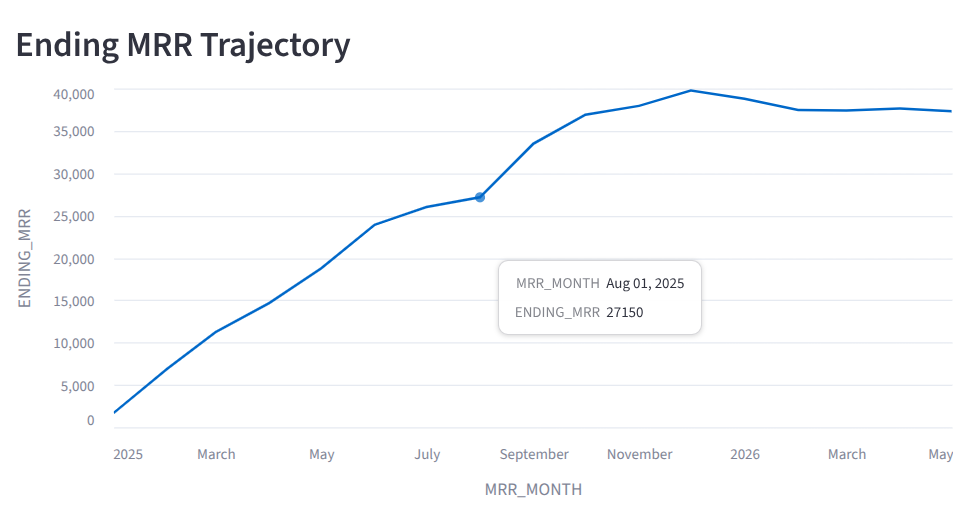

# Automated SaaS MRR Analytics Pipeline
> **A 3-Part Analytics Engineering Guide: Cloud-Native (Snowflake) or Locally Hosted (DuckDB)**

An end-to-end analytics engineering pipeline that generates synthetic SaaS subscription log data, transforms raw event streams into an automated Monthly Recurring Revenue (MRR) waterfall model with dbt data quality assertions, and renders executive reporting dashboards.

### Choose Your Own Adventure
* **Option A (Cloud-Native):** `Python` -> `Snowflake` -> `dbt-snowflake` -> `Streamlit in Snowflake`
* **Option B (Zero-Cost Local):** `Python` -> `DuckDB` -> `dbt-duckdb` -> `Local Streamlit`

---

## Part 3: Executive Dashboarding with Streamlit

### Technical Overview
* **Visualization:** Building an executive-facing financial dashboard using Streamlit—either deployed natively inside Snowflake (SiS) or run locally using DuckDB.

#### Prior Steps
* [Part 1: Data Generation and Ingestion](PART_1_INGESTION.md)
* [Part 2: dbt Data Processing](PART_2_DBT.md)

---

### The Unified Streamlit Application

By leveraging environment variables, we can write a **single, unified Streamlit application** (`app.py`) that switches its data source based on `TARGET_DB` in your `.env` file. When `TARGET_DB=duckdb`, it queries your local DuckDB database; otherwise, it defaults to querying Snowflake via active Snowpark sessions.

Create `app.py` in your project root (`~/code/saas_mrr_dbt/app.py`):

```python
import os
import streamlit as st
from dotenv import load_dotenv

load_dotenv()

st.set_page_config(page_title="SaaS MRR Dashboard", layout="wide")

@st.cache_data
def load_mrr_data():
    target = os.getenv("TARGET_DB", "snowflake").lower()
    
    if target == "duckdb":
        import duckdb
        conn = duckdb.connect("data/saas_analytics.duckdb")
        df = conn.query("SELECT * FROM dev.fct_mrr_monthly_waterfall ORDER BY mrr_month").df()
        conn.close()
    else:
        from snowflake.snowpark.context import get_active_session
        session = get_active_session()
        df = session.sql("SELECT * FROM SAAS_ANALYTICS.DEV.FCT_MRR_MONTHLY_WATERFALL ORDER BY MRR_MONTH").to_pandas()
    
    # Standardize column headers to uppercase across platforms
    df.columns = [c.upper() for c in df.columns]
    return df

df = load_mrr_data()

st.title("SaaS Executive MRR Dashboard")

if df.empty:
    st.warning("No MRR waterfall data found. Please run your dbt models first.")
    st.stop()

latest = df.iloc[-1]

# Executive KPI Cards
col1, col2, col3 = st.columns(3)
col1.metric("Ending MRR", f"${latest['ENDING_MRR']:,.0f}")
col2.metric("New MRR", f"${latest['NEW_MRR']:,.0f}")
col3.metric("Churn MRR", f"${latest['CHURN_MRR']:,.0f}")

st.markdown("---")

# Visual Trend Analysis
st.subheader("MRR Movement Over Time")
st.bar_chart(
    df, 
    x="MRR_MONTH", 
    y=["NEW_MRR", "EXPANSION_MRR", "CONTRACTION_MRR", "CHURN_MRR"]
)

st.subheader("Ending MRR Trajectory")
st.line_chart(df, x="MRR_MONTH", y="ENDING_MRR")
```

### Deployment & Execution

#### Option A: Streamlit in Snowflake (SiS)

Log into your Snowflake console. On the left side panel, navigate to Workspaces -> Streamlit. Click **+ Streamlit App**. Select your Database (`SAAS_ANALYTICS`), Schema (`DEV`), and Warehouse (`COMPUTE_WH`). These should all match the values you set in your initial `.env` file. Paste the above `app.py` code into the main editor window and click Run.

#### Option B: Locally Hosted Streamlit (DuckDB)

Ensure your virtual environment is active:

```bash
. .venv/bin/activate # from the main saas_mrr_dbt/ directory
```
 And then run the Streamlit app:

```bash
streamlit run app.py
```

This will cause Streamlit to spin up a local web server (typically at `http://localhost:8501`), displaying your interactive MRR Waterfall Dashboard. If you're using local Streamlit, it will provide you with options to deploy the app directly from the dashboard.




